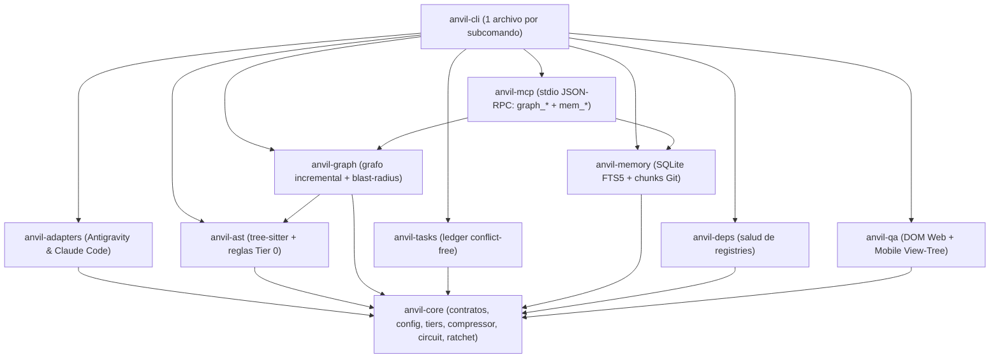

# `anvil` — Plan Maestro de Arquitectura e Implementación

> **Propósito**: Harness integral de ingeniería para agentes de IA (**Antigravity** y **Claude Code**), compilado como binario nativo en **Rust** sin dependencias externas de runtime. Integra en una arquitectura modular estrictamente separada por responsabilidad única (SRP): `tree-sitter` embebido, **motor propio de grafo de código incremental (`anvil-graph`)**, **memoria persistente local + Git conflict-free estilo Engram (`anvil-memory`)**, **servidor MCP unificado (`anvil-mcp`)**, ejecución por niveles de alta velocidad, QA visual híbrido, *ratcheting* gobernado de linters y registro de tareas libre de conflictos para equipos.

---

## 1. Filosofía y Principios Rectores

Basado en **"All Code Is Slop (Except Mine)"** (*Lauren Tan / poteto*, SpaceX / xAI) y en el enfoque *local-first* de **Engram** (*Gentleman-Programming*), adaptados a equipos multi-repositorio:

1. **Pirámide Invertida de Confianza**:
   - **Base determinista**: tipos estrictos, límites de dependencias, AST/linters ultrarrápidos y prohibición dura de *escape hatches*.
   - **Capa media (verificación acotada)**: análisis de *blast-radius* (`anvil-graph` + compilador del lenguaje), tests afectados y aserciones programáticas de UI.
   - **Cima (prosa y juicio humano)**: `AGENTS.md` / `CLAUDE.md` ultracompactos (< 150 líneas) que delegan la disciplina a comandos deterministas, nunca manuales extensos que el LLM olvida bajo presión.
2. **Frontera Estricta entre Grafo, Reglas y Memoria**:
   - **Estructura de código, símbolos, props e imports** → siempre vivos en **`anvil-graph`** (nunca prosa en memoria).
   - **Errores repetitivos y prohibiciones** → se gradúan en reglas deterministas con **`anvil ratchet`** (nunca notas olvidables).
   - **El *por qué* de decisiones (ADRs), *gotchas* de entorno/dependencias, reglas de negocio y continuidad entre sesiones** → viven en **`anvil-memory`** con validación automática de frescura contra `anvil-graph`.
3. **Jardín de Software con Gobernanza**: los errores del agente se gradúan a reglas de linting solo en retrospectiva con aprobación humana y triple filtro — evitando fatiga de linters y falsos positivos.
4. **Cero *Rationalization Escape Hatches***: los comentarios `TODO`/narrativos y las supresiones (`!important`, `@ts-ignore`, `eslint-disable`) ciegan al agente y degradan calidad/SonarQube; se bloquean por defecto salvo excepción estructurada y aprobada.
5. **Fuente Única de Verdad + Adaptadores Delgados**: toda la lógica reside en el binario `anvil` y `.harness/`. Los archivos de Antigravity (`.agents/`) y Claude Code (`.claude/`) son enlaces finos sincronizados con `anvil sync`.
6. **Velocidad y Presupuesto de Contexto**: ejecución por **Tiers (0 / 1 / 2)**, compresión agresiva de logs (`anvil run`) y *Progressive Disclosure* en memoria y grafo para no contaminar la ventana del LLM.
7. **Modularidad Radical (SRP) en el propio `anvil`**: nada de archivos monolíticos infinitos. Cada crate, módulo y archivo tiene **una sola responsabilidad**, dependencias acíclicas y límites duros de tamaño para garantizar mantenibilidad a largo plazo.

---

## 2. Decisiones Técnicas Cerradas

| Decisión | Elección | Razón |
| :--- | :--- | :--- |
| **Nombre CLI / proyecto** | `anvil` | Corto (5 letras), directo, memorable; evoca templar y validar código a golpes deterministas. |
| **Lenguaje y runtime** | **Rust `1.100.0`** (Edition 2024, binario nativo sin runtime externo) | Arranque < 5 ms, mínimo consumo de memoria, paralelismo nativo con `rayon`. |
| **Análisis AST embebido** | **`tree-sitter` embebido** (compilado con MSVC Build Tools / cc nativo) | Un solo parseo por archivo para Tier 0 AST-preciso (cero falsos positivos en `TODO`, barrels, `any`, supresiones) **y** construcción del grafo de código. |
| **Motor de grafo propio** | **`anvil-graph` nativo en Rust** (filosofía Graphify, mantenido por nosotros) | Cero dependencia de Python/`uv`/`graphifyy`; actualización incremental en **< 10 ms por edición** (grafo jamás obsoleto); resolución a medida de alias `tsconfig`, JSX props, templates HTML de Angular, DI de NestJS, Kotlin/Compose y Dart/Flutter. Compatibilidad opcional de lectura con `graphify-out/graph.json`. |
| **Memoria persistente propia** | **`anvil-memory` nativo en Rust** (filosofía Engram: `rusqlite` bundled + FTS5 + chunks inmutables en Git) | Búsqueda BM25 < 1 ms sin vector DB ni Docker; *Progressive Disclosure*; `topic_key` upserts; cero conflictos de merge en equipo; detección automática de memoria obsoleta cruzada con `anvil-graph`. |
| **Interfaz MCP unificada** | **`anvil mcp`** (servidor `stdio` único integrado en el binario) | Antigravity y Claude Code consumen herramientas `graph_*` y `mem_*` desde un único proceso liviano. |
| **Distribución** | CLI reutilizable instalable (`anvil init` en cualquier repo o workspace multi-repo) | Un único binario distribuible para todo el equipo. |
| **Carpeta unificada y raíz limpia** | `.harness/` (fuente única de verdad) + `tasks.json` raíz autogenerado | Mantiene la raíz limpia y concentra configuración, reglas, memoria y tareas en un solo lugar. |
| **Planes sin conflictos en equipo** | En **este repo**: `.harness/docs/PLAN.md`. En **repos destino**: `.harness/tasks/<TASK-ID>/plan-<gh-user>.md` | Elimina conflictos de merge cuando varias personas trabajan simultáneamente en distintas tareas. |

---

## 3. Reglas de Modularidad y Responsabilidad Única (SRP) del Proyecto `anvil`

Estas reglas aplican **de forma obligatoria** a todo el código fuente de `anvil` desde el primer commit (y luego se autoverifican con *self-dogfooding*):

1. **Presupuesto estricto de tamaño por archivo**:
   - **Objetivo blando**: `≤ 250` líneas por archivo `.rs`.
   - **Tope duro**: `≤ 350` líneas por archivo `.rs` (si un módulo se acerca al tope, se segmenta en submódulos por responsabilidad antes de crecer).
   - **Funciones cohesivas**: `≤ 50–60` líneas por función; `clippy::too_many_lines` y `clippy::cognitive_complexity` habilitados en workspace lints.
2. **Estilo moderno de módulos Rust (Edition 2024)**:
   - Usar `modulo.rs` + `modulo/submodulo.rs` en lugar de `mod.rs` gigantes.
   - Prohibido crear archivos "dios" (`utils.rs`, `helpers.rs`, `common.rs` sin cohesión) ni *barrels* innecesarios que oculten dependencias.
3. **DAG acíclico de crates (compilación paralela y bajo acoplamiento)**:
   - Los crates de dominio (`anvil-ast`, `anvil-graph`, `anvil-tasks`, `anvil-memory`, `anvil-deps`, `anvil-qa`, `anvil-adapters`) dependen únicamente de contratos/tipos compartidos en `anvil-core` (y `anvil-graph` sobre el parser de `anvil-ast`).
   - La comunicación entre `anvil-memory` y `anvil-graph` (chequeo de frescura de símbolos/archivos) pasa por un trait ligero definido en `anvil-core` (`SymbolFreshnessProvider`) para que ambos crates compilen en paralelo sin acoplamiento circular.
   - `anvil-cli` es una capa fina de cableado: **un archivo por subcomando**, sin lógica de negocio dentro del CLI.

### Mapa Modular del Workspace Cargo



### Segmentación de Archivos por Responsabilidad

```text
harness/
├── Cargo.toml                              # Workspace Cargo + workspace clippy/rust lints estrictos
├── .harness/docs/PLAN.md                   # Este documento maestro
├── templates/                              # Plantillas embebidas (include_dir!) para init/sync/skills/js
└── crates/
    ├── anvil-core/src/                     # Contratos, políticas y utilidades de dominio (sin lógica pesada)
    │   ├── config.rs                       # Esquema y carga de .harness/config.json
    │   ├── traits.rs                       # Traits compartidos (LanguageExtractor, SymbolFreshnessProvider, OutputParser)
    │   ├── stack_detector.rs               # Detección multi-stack y multi-repo
    │   ├── diff_classifier.rs              # Clasificación git diff -> Tier 0 / 1 / 2
    │   ├── circuit_breaker.rs              # Fingerprints y máquina de estados CLOSED/OPEN (N=3)
    │   ├── ratchet.rs                      # Candidatos, triple filtro y graduación de reglas
    │   ├── git.rs                          # Wrapper ligero de comandos git e identidad gh
    │   └── compressor/                     # 1 archivo por herramienta parseada
    │       ├── mod.rs                      # Orquestación, tope de líneas/tokens y logs raw
    │       ├── tsc.rs
    │       ├── eslint_biome.rs
    │       ├── vitest_jest.rs
    │       ├── pytest_ruff.rs
    │       ├── gradle_kotlin.rs
    │       └── dart_flutter.rs
    │
    ├── anvil-ast/src/                      # Parseo único tree-sitter + reglas Tier 0 (1 archivo por regla/lenguaje)
    │   ├── parser.rs                       # Pool de parsers tree-sitter por extensión
    │   ├── extractors/                     # Extracción AST cruda por lenguaje
    │   │   ├── typescript.rs
    │   │   ├── angular_html.rs
    │   │   ├── python.rs
    │   │   ├── kotlin.rs
    │   │   ├── dart.rs
    │   │   └── css.rs
    │   └── rules/                          # 1 archivo = 1 regla determinista Tier 0
    │       ├── escape_hatches.rs           # !important, @ts-ignore, eslint-disable, # noqa, anvil-allow
    │       ├── comments.rs                 # TODO/FIXME/HACK + detección de comentarios narrativos
    │       ├── strict_types.rs             # any explícito, dynamic innecesario
    │       ├── barrels.rs                  # Detección AST de re-exports puros
    │       └── root_hygiene.rs             # Allowlist de archivos en raíz
    │
    ├── anvil-graph/src/                    # Motor propio de grafo incremental (reemplaza Graphify)
    │   ├── model.rs                        # Nodos, aristas tipadas y esquemas serializables
    │   ├── store.rs                        # Persistencia binaria + caché incremental por hash blake3
    │   ├── builder.rs                      # Construcción paralela (rayon) y actualización por archivo (< 10 ms)
    │   ├── resolvers/                      # 1 archivo por estrategia de resolución de imports/framework
    │   │   ├── tsconfig.rs                 # Alias paths/baseUrl + resolución TS/JS/JSX
    │   │   ├── angular.rs                  # Selectores @Component <-> templates .html + DI
    │   │   ├── nestjs.rs                   # @Module imports/providers/controllers
    │   │   ├── python.rs                   # Paquetes e imports relativos/absolutos
    │   │   ├── kotlin.rs                   # Packages, @Composable y módulos Gradle
    │   │   └── dart.rs                     # package: y rutas relativas
    │   ├── query.rs                        # query (BM25/símbolos), path, explain, origin
    │   ├── analytics.rs                    # Comunidades Louvain, God Nodes, ciclos, reporte/HTML
    │   ├── impact.rs                       # Reverse-BFS + invocación filtrada de compiladores nativos
    │   ├── merge.rs                        # Grafo unificado multi-repo
    │   └── graphify_compat.rs              # Lectura opcional de capa semántica en graphify-out/graph.json
    │
    ├── anvil-memory/src/                   # Memoria persistente estilo Engram (local SQLite + chunks Git)
    │   ├── model.rs                        # Observation, TopicKey, MemoryKind, FreshnessStatus
    │   ├── schema.rs                       # Migraciones SQLite + tabla virtual FTS5 (BM25)
    │   ├── store.rs                        # CRUD, upsert por topic_key, TTL de sesión
    │   ├── chunks.rs                       # Export/import de chunks JSONL inmutables en .harness/memory/chunks/
    │   ├── redactor.rs                     # Limpieza de <private> y escaneo de secretos/tokens
    │   ├── staleness.rs                    # Validación de frescura vía SymbolFreshnessProvider
    │   └── query.rs                        # Progressive disclosure: search -> timeline -> get
    │
    ├── anvil-mcp/src/                      # Servidor MCP stdio unificado (Antigravity + Claude Code)
    │   ├── transport.rs                    # Protocolo JSON-RPC 2.0 sobre stdin/stdout
    │   ├── router.rs                       # Despacho de herramientas y esquemas JSON
    │   ├── tools_graph.rs                  # graph_impact, graph_origin, graph_explain, graph_path, graph_query
    │   └── tools_memory.rs                 # mem_save, mem_search, mem_timeline, mem_get, mem_context
    │
    ├── anvil-tasks/src/                    # Task Ledger conflict-free en equipo
    │   ├── model.rs                        # TaskMeta, TaskEntry, TaskStatus, ConsolidatedTasks
    │   ├── identity.rs                     # Resolución cacheada de usuario gh / git
    │   ├── ledger.rs                       # Escritura inmutable de meta.json y entries/<user>-<ulid>.json
    │   ├── builder.rs                      # Generación determinista de tasks.json raíz
    │   └── merge_driver.rs                 # Driver Git automático para resolver tasks.json sin conflictos
    │
    ├── anvil-adapters/src/                 # Adaptadores delgados Antigravity <-> Claude Code
    │   ├── contract.rs                     # Contrato interno unificado de eventos y decisiones
    │   ├── inbox.rs                        # Cola efímera .harness/.state/inbox.json
    │   ├── antigravity.rs                  # Traductor JSON + generador .agents/hooks.json, mcp_config.json, AGENTS.md
    │   ├── claude_code.rs                  # Traductor JSON + merge seguro .claude/settings.json, .mcp.json, CLAUDE.md
    │   └── sync.rs                         # Sincronización no destructiva de reglas y skills
    │
    ├── anvil-deps/src/                     # Auditoría de dependencias Tier 2 (1 archivo por ecosistema)
    │   ├── audit.rs                        # Orquestación, caché local y umbrales de antigüedad
    │   ├── npm.rs
    │   ├── pypi.rs
    │   ├── pubdev.rs
    │   └── maven.rs
    │
    ├── anvil-qa/src/                       # QA visual híbrido Web + Móvil
    │   ├── onboarding.rs                   # Detección de plataforma UI y selección interactiva de driver
    │   ├── web.rs                          # Ejecución de aserciones DOM (Playwright/CDP) y capturas
    │   ├── mobile.rs                       # adb logcat, uiautomator XML / mobile-mcp / Roborazzi
    │   └── report.rs                       # Reporte comprimido estructurado antes/después
    │
    └── anvil-cli/src/                      # Binario delgado: solo parseo CLI y delegación (1 archivo por comando)
        ├── main.rs
        └── commands/
            ├── init.rs
            ├── sync.rs
            ├── doctor.rs
            ├── hook.rs
            ├── run.rs
            ├── check.rs
            ├── impact.rs
            ├── graph.rs
            ├── mem.rs
            ├── mcp.rs
            ├── tasks.rs
            ├── ratchet.rs
            ├── circuit.rs
            ├── deps.rs
            ├── qa.rs
            └── context.rs
```

---

## 4. Ecosistema Objetivo (Multi-Stack y Multi-Repo)

Diseñado a partir de la inspección del entorno real (`C:\Development\Fliiper`: workspaces multi-repo **Centinela** y **Fliiper**) y extensible vía traits:

| Stack | Manifiestos de detección | Extracción de grafo (`anvil-graph`) | Typechecker / Compilador | Linter | Tests focalizados |
| :--- | :--- | :--- | :--- | :--- | :--- |
| **React / Vite / Next.js / Astro** | `package.json` + `tsconfig*.json` | Imports + alias `tsconfig`, símbolos, llamadas, JSX `<Comp prop=.../>`, re-exports | `tsc --noEmit` | `eslint` / `biome` | `vitest related` / `jest --findRelatedTests` |
| **Angular (+ Tauri)** | `angular.json` + `tsconfig.app.json` | TS imports/DI + `@Component(selector)` vinculado a templates `.html` | `ngc --noEmit` / `tsc -p tsconfig.app.json --noEmit` | `eslint` | `jest --findRelatedTests` / `ng test --include` |
| **NestJS** | `nest-cli.json` + `tsconfig.json` | Imports, `@Module` (imports/providers/controllers), inyección por constructor | `tsc --noEmit` | `eslint` | `jest --findRelatedTests` |
| **React Native / Expo** | `app.config.ts` / `app.json` | Imports + alias `tsconfig`/Babel, JSX props, navegación | `tsc --noEmit` | `eslint` | `jest --findRelatedTests` |
| **Python** | `pyproject.toml` | `import`/`from ... import`, clases, funciones, llamadas, herencia | `pyright` / `mypy` | `ruff check` | `pytest <mapped_tests>` |
| **Kotlin / Android (Compose)** | `build.gradle.kts` / `settings.gradle.kts` | `package`/imports, clases, `@Composable`, llamadas, módulos Gradle | `./gradlew :<mod>:compileDebugKotlin` | `ktlint` / `detekt` | `./gradlew :<mod>:testDebugUnitTest --tests` / Roborazzi |
| **Flutter / Dart** | `pubspec.yaml` | `package:` y relative imports, widgets, clases, métodos | `dart analyze <files>` | `dart analyze` | `flutter test <mapped_tests>` |

### Estructura inyectada en un proyecto destino (`anvil init`)

```text
<proyecto-destino>/
├── tasks.json                          # Vista consolidada autogenerada y determinista (reconstruible)
├── AGENTS.md                           # Adaptador delgado para Antigravity (< 150 líneas)
├── CLAUDE.md                           # Adaptador delgado para Claude Code (< 150 líneas)
├── .mcp.json                           # Registra `anvil mcp` para Claude Code (merge no destructivo)
├── .agents/
│   ├── hooks.json                      # Conecta eventos a `anvil hook <event> --adapter antigravity`
│   ├── mcp_config.json                 # Registra `anvil mcp` para Antigravity (merge no destructivo)
│   └── skills/                         # Preserva skills del proyecto + añade skills de anvil
├── .claude/
│   ├── settings.json                   # Merge seguro de hooks hacia `anvil hook <event> --adapter claude`
│   └── skills/                         # Sincronizado desde .harness/skills/
└── .harness/
    ├── config.json                     # Stacks detectados, comandos, políticas y umbrales
    ├── rules/                          # Reglas graduadas del proyecto (versionadas)
    ├── candidates/                     # Errores candidatos a regla (aún no bloqueantes)
    ├── skills/                         # Fuente única de verdad de skills del harness
    ├── memory/
    │   └── chunks/
    │       └── <gh-user>-<ulid>.jsonl  # Chunks inmutables de memoria compartible en equipo (0 conflictos)
    ├── tasks/                          # Fuente de verdad de tareas libre de conflictos
    │   └── T-20261121-01J.../
    │       ├── meta.json               # ID único, creador (gh), prompt original, created_at
    │       ├── plan-<gh-user>.md       # (Opcional) Plan de esa tarea aislado por autor
    │       └── entries/
    │           └── <gh-user>-<ulid>.json  # Resumen conciso del LLM, estado, archivos, rama
    └── .state/                         # (gitignored) anvil.db (SQLite FTS5), graph.bin, hashes, circuit.json, inbox.json, logs
```

---

## 5. Diseño Detallado de Subsistemas

### 5.1 Puente de Hooks y Paridad Antigravity ↔ Claude Code

En **Claude Code**, `PostToolUse` devuelve contexto directo al modelo. En **Antigravity**, `PostToolUse` espera `{}` y el feedback al LLM se inyecta vía `PreInvocation` (`injectSteps`), `PreToolUse` (`deny`/`overwrite`) o `Stop` (`decision: "continue"`). `anvil` abstrae esta asimetría mediante `.harness/.state/inbox.json`:

| Evento | Acción común en `anvil hook` | Traducción Antigravity | Traducción Claude Code |
| :--- | :--- | :--- | :--- |
| `SessionStart` | Sincronizar chunks nuevos en `anvil.db`, verificar índice incremental `anvil-graph`, inyectar resumen compacto de tarea activa y contexto crítico | `injectSteps` (`systemMessage`) | `additionalContext` |
| `PreToolUse` | Verificar Circuit Breaker abierto; bloquear escapes/comandos prohibidos; envolver tests/linters con `anvil run` | `allow` / `deny` / `overwrite` | `permissionDecision` / `updatedInput` |
| `PostToolUse` | Parseo único `tree-sitter`: **Tier 0** AST + actualización incremental de **`anvil-graph`** (< 10 ms) + invalidación de memorias ligadas al archivo modificado; actualizar Circuit Breaker; escribir hallazgos en `inbox.json` | Devuelve `{}` (entrega en siguiente `PreInvocation`) | Devuelve `additionalContext` inmediato y vacía `inbox.json` |
| `PreInvocation` | *(Antigravity)* Consumir y vaciar `inbox.json` si hay diagnósticos pendientes | `injectSteps` (`systemMessage`) | N/A |
| `Stop` | Ejecutar **Tier 1** (`anvil check`: blast-radius + typecheck + tests afectados); actualizar entrada de tarea + `tasks.json`; avisar si falta QA visual (Tier 2) | `decision: "continue"` + `reason` si falla gate | `decision: "block"` + `reason` si falla gate |

---

### 5.2 Velocidad por Niveles (Tiered Execution)

El clasificador sobre `git diff` asigna cada cambio a categorías (`style-only`, `ui`, `logic`, `contract`, `deps`, `config`, `docs`):

| Tier | Disparador | Objetivo de latencia | Qué ejecuta |
| :--- | :--- | :--- | :--- |
| **Tier 0** | Cada edición (`PostToolUse`) | **< 500 ms** | Parseo único `tree-sitter`: reglas AST (escapes sin `anvil-allow`, `TODO`/comentarios narrativos, barrels nuevos, `any` explícito, raíz limpia) + actualización incremental de `anvil-graph` (< 10 ms) + lint puntual del archivo si está habilitado. |
| **Tier 1** | Cierre de turno (`Stop`) o `anvil check` | **< 15 s** | `anvil impact` (reverse-BFS sobre `anvil-graph` + compilador nativo filtrado a archivos tocados e impactados) + tests unitarios mapeados únicamente al radio de impacto. Si el diff es `style-only` (ej. color de botón), **omite suites de lógica no relacionadas** y solo marca verificación visual acotada. |
| **Tier 2** | Cambios UI, cambios en manifiestos de deps o `anvil check --full` | **Bajo demanda** | QA visual híbrido (DOM/árbol de vistas + capturas antes/después) y auditoría de dependencias obsoletas (`anvil deps`). |

---

### 5.3 Motor Propio de Grafo (`anvil-graph`) y Blast-Radius (`anvil impact`)

1. **Extracción paralela e incremental (`blake3` + `rayon` + `tree-sitter`)**:
   - Cold build en **~200–600 ms** para ~5k nodos; actualización incremental de 1 archivo en **< 10 ms** dentro de `PostToolUse`. El grafo nunca queda obsoleto.
   - Rutas siempre normalizadas relativas al repo (elimina la ambigüedad de basenames).
2. **Semántica real de frameworks**:
   - Alias `tsconfig.json`, usos de props JSX (`<Button prop=.../>`), selectores Angular ↔ templates `.html`, `@Module`/DI de NestJS, paquetes Python, Kotlin/Compose y Dart/Flutter.
3. **Analítica y CLI propio**:
   - `anvil graph build|update|query|path|explain|report|merge`: comunidades Louvain, *God Nodes*, ciclos de importación, grafos cruzados multi-repo (`fliiper/`, `centinela/`), reporte compacto y exportación `graph.html` opcional.
   - Compatibilidad opcional de lectura con `graphify-out/graph.json` para nodos semánticos existentes.
4. **Blast-Radius (`anvil impact`)**:
   - Reverse-BFS desde archivos/símbolos modificados (`--depth 2`) + compilador nativo (`tsc`, `ngc`, `pyright`, `gradlew`, `dart analyze`) filtrado a `modified ∪ impacted`, reportando al LLM el consumidor exacto que se rompió (ej. pantalla que pasa una prop inválida) y su firma esperada.

---

### 5.4 Memoria Persistente Propia (`anvil-memory`) y Servidor MCP Unificado (`anvil-mcp`)

Inspirado en la filosofía *local-first* de **Engram** (*Gentleman-Programming*), diseñado a medida para convivir sin contradicciones con la filosofía anti-*slop*:

1. **Almacenamiento local + sincronización conflict-free en equipo**:
   - **Fuente portable en Git**: chunks JSONL inmutables en `.harness/memory/chunks/<gh-user>-<ulid>.jsonl` (**0% conflictos de merge** entre compañeros).
   - **Índice local de alta velocidad**: SQLite + FTS5 embebido (`rusqlite` con feature `bundled`, cero dependencias externas) en `.harness/.state/anvil.db` (gitignored), sincronizado automáticamente al detectar chunks nuevos.
2. **Progressive Disclosure (ahorro extremo de tokens)**:
   - `mem_search(query, kind?, limit?)`: devuelve solo títulos, `topic_key`, `kind`, fecha y estado de frescura (unos pocos tokens).
   - `mem_timeline(id|topic_key)`: contexto cronológico compacto de un tema.
   - `mem_get(id)`: carga el cuerpo completo únicamente cuando el agente lo necesita.
   - `mem_save(topic_key, kind, what, why, where, learned, related_files?, related_symbols?)`: realiza **upsert** por `topic_key` para evitar duplicación infinita.
3. **Frontera estricta + Anti-Obsolescencia automática (mejora clave sobre Engram)**:
   - Solo acepta 4 categorías válidas: `decision` (ADRs y porqués), `gotcha` (trampas de librerías/entorno, ej. restricciones de versiones), `domain` (reglas de negocio) y `session` (continuidad temporal con TTL/decaimiento automático).
   - **Prohibido guardar estructura de código o reglas de estilo** (eso pertenece a `anvil-graph` y `anvil ratchet`).
   - **Invalidación cruzada con `anvil-graph`**: cuando un archivo o símbolo vinculado en `related_files`/`related_symbols` sufre cambios estructurales, `anvil-memory` marca la observación como `needs_verification` para que el agente nunca confíe ciegamente en una memoria envejecida.
4. **Privacidad y seguridad por defecto (`redactor.rs`)**:
   - Elimina bloques `<private>...</private>` y redacta automáticamente patrones de API keys, tokens JWT, contraseñas y strings de conexión antes de persistir cualquier chunk o registro en SQLite.
5. **Servidor MCP único (`anvil mcp`)**:
   - Expone por `stdio` tanto las herramientas de grafo (`graph_impact`, `graph_origin`, `graph_query`, `graph_path`, `graph_explain`) como las de memoria (`mem_save`, `mem_search`, `mem_timeline`, `mem_get`, `mem_context`) para Antigravity y Claude Code desde el mismo binario.

---

### 5.5 Balance de Código: Anti-Slop + Anti-Sobreingeniería + Higiene

- **Tier 0 AST (`tree-sitter`, cero falsos positivos en literales)**:
  - Bloquea `!important`, `@ts-ignore`, `@ts-expect-error`, `eslint-disable`, `# noqa`, `@Suppress(...)`, `// ignore:` salvo formato aprobado `anvil-allow(<regla>): <motivo> [<ref>]`.
  - Bloquea `TODO`, `FIXME`, `HACK`, `XXX` en comentarios (protege SonarQube) y advierte comentarios narrativos/minicontexto que ciegan al agente; permite documentación breve orientada al propósito/contrato/invariante.
  - Detecta `any` explícito en TS (`strict: true` auditado por `anvil doctor`), archivos *barrel* puros nuevos (`index.{ts,tsx,js,jsx}`) y archivos fuera de allowlist en la raíz.
- **Anti-sobreingeniería (Pre-edit + Tier 1)**:
  - Regla de origen real (`anvil impact --origin`) para tocar la fuente exacta en lugar de parchear aguas abajo.
  - Heurística de proporcionalidad: alerta si un ajuste pequeño introduce archivos nuevos, abstracciones con un único consumidor en `anvil-graph` o dependencias externas no solicitadas.
- **Salud de dependencias (`anvil deps`, Tier 2 en cambios de manifiestos)**:
  - Consulta npm, PyPI, pub.dev y Maven Central (con caché local) para alertar paquetes deprecados, archivados o sin releases en > 24 meses.

---

### 5.6 Compresión de Contexto (`anvil run`), Circuit Breakers (`anvil circuit`) y Subagentes

- **`anvil run -- <cmd>`**: parseadores dedicados (`tsc`, `eslint`, `biome`, `vitest`, `jest`, `pytest`, `ruff`, `gradle`, `dart`). Si pasa: 1 línea (`PASS`). Si falla: únicamente archivo, línea, código y extracto con tope duro (**50 líneas / ~1.2k tokens**); log completo archivado en `.harness/.state/logs/`.
- **Circuit Breaker (`N = 3`)**: fingerprint normalizado en `.harness/.state/circuit.json`. Al 3er fallo consecutivo del mismo error (linter, compilador o check visual), `PreToolUse`/`Stop` bloquean intentos ciegos y obligan a escalar al humano con resumen estructurado; se desbloquea con `anvil circuit reset`.
- **Matriz de Enrutamiento de Subagentes** (skill sincronizada + `anvil context pack`):
  - **Delegar a modelo menor**: refactors mecánicos repetitivos (≥ 3 archivos con patrón cerrado), boilerplate/tests con plantilla existente, lectura/resumen aislado con rutas filtradas por `anvil-graph`.
  - **Hacer inline**: ediciones triviales de 1–2 líneas (el overhead del subagente no compensa).
  - **Prohibido delegar**: decisiones de diseño/arquitectura, contratos compartidos o debugging multi-archivo ambiguo.

---

### 5.7 Ratchet de Linters Gobernado (`anvil ratchet`)

1. Durante una feature, errores del agente se registran en `.harness/candidates/<id>.json` sin modificar linters ni ensuciar el PR.
2. En retrospectiva con aprobación humana (`anvil ratchet review` / `test` / `promote`), una regla solo se gradúa si cumple el triple filtro: **(1)** recurrencia ≥ 2 o alto impacto, **(2)** determinismo + ejecución < 200 ms, **(3)** validación de falsos positivos sobre el repositorio actual.

---

### 5.8 QA Visual Híbrido (Web + Móvil) con Onboarding Interactivo

1. **Onboarding interactivo**: si un cambio toca UI y no hay driver configurado, el agente pregunta al usuario qué herramienta habilitar/instalar:
   - **Web**: Chrome DevTools MCP / Playwright / Browser integrado / omitir.
   - **Móvil**: Emulador Android (`adb` + `mobile-mcp`) / **Roborazzi** (Kotlin/Compose) / Maestro / omitir.
2. **Checks programáticos obligatorios (antes de capturas)**:
   - **Web**: `console.error`/`pageerror == 0`, scroll horizontal inesperado, texto desbordado/recortado sin contenedor scrolleable ni ellipsis intencional, solapamiento de *bounding boxes* interactivos, controles colapsados (`0×0`), imágenes rotas.
   - **Móvil**: `adb logcat` sin `FATAL EXCEPTION`/ANR, nodos truncados o fuera de viewport en `uiautomator dump`/`mobile-mcp`, controles superpuestos y soporte a diffs de Roborazzi.
3. **Inspección visual dirigida**: capturas antes/después (desktop + mobile viewport) evaluadas junto al reporte JSON de aserciones.

---

### 5.9 Registro de Tareas Conflict-Free en Equipo (`.harness/tasks/` → `tasks.json`)

- Identidad resuelta con `gh api user --jq .login` (cacheada, fallback `git config user.name`).
- Cada tarea crea `.harness/tasks/<TASK-ID>/meta.json` (ID ordenable único, autor, texto exacto del pedido) y cada avance/cierre crea un archivo inmutable `.harness/tasks/<TASK-ID>/entries/<gh-user>-<ulid>.json` (estado, rama, archivos tocados, resumen conciso del LLM).
- Varios desarrolladores trabajando a la vez en la **misma tarea** escriben archivos distintos en `entries/` → **0 conflictos de merge**.
- `anvil tasks build` regenera deterministamente `tasks.json` en la raíz (protegido con Git merge driver / `post-merge` automático).

---

## 6. Plan de Implementación por Fases

Cada fase produce código modular (respetando el límite de ≤ 250–350 líneas/archivo y `clippy -D warnings`), compilado y validado con pruebas automatizadas antes de avanzar.

### Fase 1 — Fundaciones Rust (SRP), Adaptadores, Compresor, Circuit Breaker y Tier 0 AST
- **Crates**: `anvil-core`, `anvil-ast`, `anvil-adapters`, `anvil-cli` (comandos base).
- **Entregables**:
  - Workspace Cargo con lints estrictos (`too_many_lines`, `cognitive_complexity`, `pedantic` selectivo) y estructura SRP.
  - `anvil init`, `anvil sync`, `anvil doctor` (merge no destructivo preservando skills previas).
  - Adaptadores finos Antigravity (`.agents/hooks.json`, `AGENTS.md`) y Claude Code (`.claude/settings.json`, `CLAUDE.md`) con buzón `inbox.json`.
  - `anvil run -- <cmd>` (parseadores modulares por herramienta + tope de tokens) y `anvil circuit` (`N=3`).
  - `anvil-ast` con `tree-sitter` embebido (TS/TSX, JS, CSS, Python, Kotlin, Dart) y 5 reglas Tier 0 en archivos separados (< 500 ms).
- **Criterio "Done"**: `cargo test` y `cargo clippy -- -D warnings` en verde; todos los archivos fuente dentro del presupuesto SRP; contrato JSON de hooks probado para Antigravity y Claude Code; `TODO` en string no da falso positivo y `// TODO` sí bloquea; 3 fallos activan el Circuit Breaker.

### Fase 2 — Motor Propio de Grafo en Rust (`anvil-graph`), Blast-Radius (`anvil impact`) y Tiers (`anvil check`)
- **Crates**: `anvil-graph` + integración en `anvil-cli` y `PostToolUse`.
- **Entregables (2 hitos internos)**:
  - **Hito 2A**: núcleo incremental `blake3` + `rayon` + `petgraph`, trait `LanguageExtractor`, extractores y resolutores de TS/JS/JSX (`tsconfig.json`), Angular templates `.html`, NestJS y Python; comandos `anvil graph build|update|query|path|explain|report`; overlay opcional para `graphify-out/graph.json`; actualización incremental en `PostToolUse` (< 10 ms).
  - **Hito 2B**: extractores Kotlin/Compose y Dart/Flutter; `anvil graph merge` multi-repo; detector multi-stack/multi-repo; `anvil impact` (reverse-BFS + compiladores nativos) y `anvil check` con clasificador Tier 0/1/2 + heurística anti-sobreingeniería (`--origin`).
- **Criterio "Done"**: benchmark real (solo lectura) en `C:\Development\Fliiper\fliiper\fliiper-front`: cold build < 1 s, update incremental de 1 archivo < 15 ms, reverse-BFS < 5 ms; en *sandbox* React y Angular, romper una prop o selector reporta el consumidor/template exacto; cambio `style-only` completa Tier 1 en < 2 s sin correr suites backend.

### Fase 3 — Memoria Persistente (`anvil-memory`), Servidor MCP (`anvil-mcp`), Task Ledger, Ratchet y Deps
- **Crates**: `anvil-memory`, `anvil-mcp`, `anvil-tasks`, `anvil-deps`.
- **Entregables**:
  - `anvil-memory`: SQLite + FTS5 (`rusqlite` bundled), chunks inmutables en `.harness/memory/chunks/`, *Progressive Disclosure* (`mem_search`/`timeline`/`get`), `topic_key` upserts, redactor `<private>` + secretos, TTL de sesiones y detección automática de staleness vía `SymbolFreshnessProvider` (`anvil-graph`).
  - `anvil-mcp`: servidor MCP `stdio` unificado exponiendo `graph_*` y `mem_*`, registrado automáticamente por `anvil init`/`sync` en Antigravity (`.agents/mcp_config.json`) y Claude Code (`.mcp.json`).
  - `anvil-tasks`: `start`/`update`/`done`/`build`/`list`, identidad `gh`, planes aislados `plan-<gh-user>.md` y merge driver automático para `tasks.json`.
  - `anvil ratchet` (`log`/`review`/`test`/`promote`) y `anvil deps` (auditoría Tier 2 para npm/PyPI/pub.dev/Maven).
- **Criterio "Done"**: test Git real con 2 ramas editando simultáneamente la misma tarea y guardando memorias en paralelo hace `git merge` con **0 conflictos** y reconstruye tanto `tasks.json` como `anvil.db`; editar un archivo enlazado marca la memoria asociada como `needs_verification`; `<private>` y API keys nunca aparecen en chunks; `anvil mcp` responde herramientas `graph_*` y `mem_*` por `stdio`; ciclo completo de Ratchet y `anvil deps` verificados.

### Fase 4 — QA Visual Híbrido (Web + Móvil) y Enrutamiento de Subagentes
- **Crates**: `anvil-qa` + `anvil context pack` + skills sincronizadas.
- **Entregables**:
  - Script de aserciones DOM Web (consola, scroll horizontal, texto recortado sin scroll, solapamiento, tamaños 0, imágenes rotas) y driver móvil (`adb logcat`, `uiautomator dump`/`mobile-mcp`, Roborazzi).
  - Flujo interactivo `anvil qa` de detección de plataforma y selección/instalación de herramienta + capturas antes/después.
  - Skill sincronizada de Matriz de Enrutamiento de Subagentes y `anvil context pack` (paquete mínimo de contexto desde `anvil-graph` + memorias relevantes).
- **Criterio "Done"**: prueba E2E en web con 5 fallos deliberados detecta 5/5 deterministamente y emite reporte comprimido + capturas; validación móvil simulada detecta nodos truncados/solapados y excepción en `logcat`.

### Fase 5 — Empaquetado, Distribución, Self-Dogfooding y Piloto Real
- **Entregables**:
  - Build release optimizado (`LTO`, `strip`) para `windows/x86_64`, `macos/arm64`, `linux/x86_64` e instaladores (`install.ps1`, `install.sh`).
  - **Self-dogfooding**: activar `anvil` sobre este propio repositorio (vigilando tamaño SRP, grafo, memoria y tareas de `anvil`).
  - Piloto controlado en 1 repositorio real de `C:\Development\Fliiper` en rama de prueba, midiendo latencias reales y ergonomía tanto en Antigravity como en Claude Code.
- **Criterio "Done"**: instalación limpia en < 30 s; flujo completo de punta a punta verificado en Antigravity y Claude Code sobre el repo piloto.

---

## 7. Próximo Paso (al dar luz verde)

Al indicar que arranquemos la **Fase 1**:
1. Inicializar Git en este repositorio y crear el workspace Cargo de `anvil` con los lints SRP configurados en `Cargo.toml`.
2. Crear la estructura modular de `anvil-core`, `anvil-ast`, `anvil-adapters` y `anvil-cli` respetando el presupuesto de responsabilidad única por archivo.
3. Compilar y validar las gramáticas `tree-sitter` embebidas con `rustc 1.100.0` + MSVC Build Tools e implementar los entregables completos de Fase 1 con su suite de tests.
